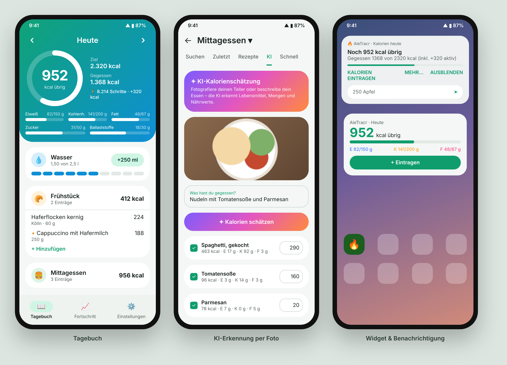

# AleTracr

Kalorien-Tracker für Android – ähnlich wie MyFitnessPal, mit **kostenloser KI-Erkennung** per Foto oder Text.



> Die Grafik ist eine Design-Vorschau (HTML-Nachbau des Compose-UI), kein Screenshot vom Gerät.

## Funktionen

**Tagebuch**
- Frühstück, Mittagessen, Abendessen, Snacks – Tage vor/zurück blättern
- Animierter Kalorienring, Makros (Eiweiß, Kohlenhydrate, Fett) sowie Zucker & Ballaststoffe
- Mahlzeit von gestern kopieren, Mahlzeit als **Rezept** speichern, Löschen mit „Rückgängig“

**Direkt im Tagebuch**
- 📷 **Essen fotografieren** → KI-Zusammenfassung mit Kalorien, Lebensmitteln und Mengen → bestätigen
- 🎤 **Per Sprache eintragen – blitzschnell & offline**: „Apfel 30 Gramm und zwei Scheiben Vollkornbrot mit Käse“
  → Mengen, Stückzahlen und Einheiten (Gramm, Scheibe, Glas, EL, Handvoll …) werden direkt auf dem Handy erkannt,
  Nährwerte kommen aus deinen bisherigen Produkten und einer eingebauten Tabelle mit ~120 Lebensmitteln.
  Wasser landet im Wasser-Tracker. Unbekanntes kann per Knopf von der KI geschätzt werden.

**Hinzufügen**
- **Produktsuche** in [Open Food Facts](https://world.openfoodfacts.org) (über 3 Mio. Produkte) + **Barcode-Scanner**
- **KI-Schätzung** per Foto und/oder Beschreibung, editierbar vor dem Speichern
- **Nährwerttabelle fotografieren** – die KI liest die Werte pro 100 g ab
- Zuletzt verwendet, Favoriten, Rezepte, **Schnelleintrag**

**Immer im Blick**
- **Homescreen-Widget**: übrige Kalorien, Makros, „+ Eintragen“
- **Dauerhafte Benachrichtigung** „Noch X kcal übrig“ – Kalorien direkt eintippen (`250 Apfel`), „Mehr…“, „Ausblenden“;
  bleibt bei „Alle löschen“ bestehen und kommt sofort zurück, falls sie weggewischt wird
- **Smarte Erinnerungen**: Frühstück/Mittag/Abend nur, wenn noch nichts eingetragen ist; Wasser-Erinnerung
- **Intervallfasten-Timer** (14/16/18 h) mit Benachrichtigung bei Ziel

**Fortschritt**
- 7-Tage-Diagramm, Gewichtsverlauf, **KI-Coach** mit Wochenanalyse und Tipps
- **Health Connect**: Schritte & aktive Kalorien erhöhen das Tagesbudget

**Daten**
- Backup/Wiederherstellen (JSON), Export als CSV (Excel)
- Kalorienbedarf-Rechner (Mifflin-St Jeor)

## KI einrichten (kostenlos)

1. Auf [aistudio.google.com/apikey](https://aistudio.google.com/apikey) mit dem Google-Konto anmelden und einen API-Key erstellen (keine Kreditkarte nötig).
2. In der App: **Einstellungen → KI → Google Gemini** und Key einfügen.
3. Gratis-Tarif hat Tageslimits; Google darf kostenlose Anfragen zur Produktverbesserung nutzen.
   Ändert Google den Modellnamen, kann er in den Einstellungen angepasst werden.

Alternativ: **Anthropic Claude** (kostenpflichtig, sehr genau) – Key von console.anthropic.com.

## Installieren

Neueste Version unter **[Releases](https://github.com/AleB-Roni/AleTracr/releases/latest)** → `AleTracr-x.y.z.apk`
herunterladen und öffnen. Neue Versionen lassen sich direkt als Update drüber installieren.

## Bauen & veröffentlichen

- Jeder Push auf `main` baut per GitHub Actions ein Test-APK (**Actions → Build APK → Artifacts**).
- Neues Release: Tag pushen, z. B. `git tag v0.2.0 && git push origin v0.2.0`
  (oder **Actions → Release → Run workflow**). Das APK wird automatisch an das Release gehängt.
- Signatur: fester Debug-Schlüssel im Repo (`app/debug.keystore`). Für einen privaten Schlüssel die Secrets
  `KEYSTORE_BASE64`, `KEYSTORE_PASSWORD`, `KEY_ALIAS` setzen – Achtung: ein Schlüsselwechsel erfordert einmalig eine Neuinstallation.

```bash
./gradlew assembleDebug
```

## Technik

Kotlin · Jetpack Compose (Material 3, Animationen) · Room · DataStore · WorkManager · Glance (Widget) ·
Health Connect · OkHttp · kotlinx.serialization · Gemini REST API · Anthropic Java SDK · ML Kit Code Scanner · Coil

Produktdaten: © Open Food Facts contributors, [ODbL](https://opendatacommons.org/licenses/odbl/1-0/).
